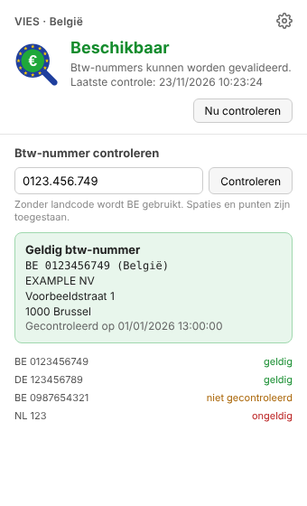

<!--
SPDX-FileCopyrightText: 2026 Optimey CommV
SPDX-License-Identifier: GPL-3.0-or-later
-->

# VIES Pulse

Shows at a glance whether VIES, the EU system that webshops use to validate VAT numbers, is available for your member state, and lets you check any EU VAT number. Comes as a Chrome extension for all EU member states and as a small Windows tray tool for Belgium.



VIES Pulse is an independent project and is not affiliated with or endorsed by the European Commission.

## Why

When the Belgian member state service behind VIES is down, every webshop that validates VAT numbers in real time fails at checkout, often with a vague "validation took too long" message. The order then either goes through with VAT you cannot deduct, or it does not go through at all. The same happens in every other member state. The official status page is a raw JSON document, so this tool watches it for you and tells you the moment your country is back.

## What is in this repository

| Folder | What |
|---|---|
| `extension/` | Chrome extension (Manifest V3) for all EU member states and Northern Ireland, in 22 languages. Toolbar icon in the status colour, a popup with the status and a VAT number check, and a notification when the chosen country comes back online. |
| `windows/` | Windows tray tool (C#, .NET Framework 4.x) for Belgium, in Dutch. A small always-on-top window with a status dot and a tray icon. |
| `tests/` | End-to-end test of the extension against a local stand-in for VIES. |

## Status colours

| Colour | Meaning |
|---|---|
| Green, steady | The chosen country is available in VIES: VAT numbers can be validated. |
| Red, pulsing | VIES is unavailable for the chosen country. |
| Orange, steady | The status page itself could not be reached (no internet, proxy and so on). |
| Grey | Not checked yet, or no country chosen. |

The status is checked once a minute. In the extension both the toolbar icon and the icon in the popup pulse while the country is unavailable; the pulse can be switched off or made faster or slower in the settings. The Windows tool blinks its dot instead.

## Requirements

- Extension: Google Chrome or another Chromium based browser (Edge, Brave, Vivaldi).
- Windows tool: Windows 10 or 11 (the .NET Framework 4.x it needs is part of Windows).

## Download

| What | Where |
|---|---|
| Chrome extension | The Chrome Web Store (link follows once the listing is approved), or load the `extension` folder yourself as described below. |
| Windows tray tool | [`release/VIES-Belgie.exe`](release/) |

The Windows build is stored with Git LFS on the Optimey LFS server, not on GitHub. Clone with [git-lfs](https://git-lfs.com) installed to get the real file; without it, or through the GitHub web interface, you only get a small pointer file. You can always build it yourself from the sources, as described below.

## Installation

### Chrome extension

```sh
git clone https://github.com/Optimey-CommV/vies-pulse.git
```

1. Open `chrome://extensions` and switch on **Developer mode**.
2. Click **Load unpacked** and select the `extension` folder.
3. Pin **VIES Pulse** from the puzzle icon in the toolbar.

Chrome loads the extension from that folder, so keep it where it is. To update: `git pull`, then click the reload arrow on the extension card.

### Windows tool

Use `release/VIES-Belgie.exe`, or build the tool yourself with the C# compiler that comes with Windows:

```powershell
powershell -ExecutionPolicy Bypass -File windows\build.ps1
```

This produces `windows\VIES-Belgie.exe`. The first time you start an unsigned executable, SmartScreen may ask for confirmation ("More info", then "Run anyway").

On Linux you can build the same executable with Mono:

```sh
mcs -target:winexe -sdk:4.5 -codepage:utf8 -r:System.Windows.Forms.dll -r:System.Drawing.dll \
    -win32icon:windows/app.ico -out:windows/VIES-Belgie.exe windows/ViesBelgie.cs
```

## Usage

### Status

The extension and the Windows tool start checking on their own. Right-click the Windows window or tray icon for **Nu controleren** (check now), **Altijd bovenaan** (always on top) and **Afsluiten** (exit). Minimising hides the window; double-click the tray icon to bring it back.

### Settings (extension)

Open the settings with the gear in the popup, or via **Details > Extension options** on `chrome://extensions`. The settings are stored with `chrome.storage.sync`, so they follow you to every computer where you are signed in to Chrome.

| Setting | Default |
|---|---|
| Country | Automatic: derived from the time zone of the computer (Europe/Brussels gives Belgium). Outside the EU no country is chosen until you pick one. |
| Language | Automatic: the language of Chrome, which by default is the language of Windows. Falls back to English. |
| Pulse | On. The icon pulses while the chosen country is unavailable. |
| Duration of one pulse | 1.60 s, adjustable from 0.01 s to 2.00 s in steps of 0.01 s. Chrome cannot swap the toolbar icon faster than about every 40 ms, so below 0.08 s only the popup follows the setting exactly. |

**Restore default settings** puts everything back as above.

Available languages: Bulgarian, Croatian, Czech, Danish, Dutch, English, Estonian, Finnish, French, German, Greek, Hungarian, Italian, Latvian, Lithuanian, Polish, Portuguese, Romanian, Slovak, Slovenian, Spanish and Swedish. Irish and Maltese are not offered because Chrome itself has no interface in those languages; English is used instead.

### Checking a VAT number (extension)

Type a VAT number in the popup and check it. Spaces, dots and dashes are ignored; without a country prefix the chosen country is assumed, and GR is translated to EL, the code VIES uses for Greece.

| Result | Meaning |
|---|---|
| Green | Valid. Name and address are shown when the member state discloses them (Belgium does, Germany and the Netherlands do not). |
| Red | Invalid, or not registered for intra-Community transactions. |
| Orange | VIES could not answer, for example because that member state is down. |

The last five checks are listed under the result; click one to check it again.

## How it works

Both tools only talk to the public VIES REST API of the European Commission:

- `GET https://ec.europa.eu/taxation_customs/vies/rest-api/check-status` for the availability per member state;
- `GET https://ec.europa.eu/taxation_customs/vies/rest-api/ms/{country}/vat/{number}` for a single VAT number (extension only).

No other servers are contacted and nothing is sent anywhere else. See the [privacy policy](PRIVACY.md). The extension keeps the last status and the last five checked numbers in `chrome.storage.local`, on your own machine, and its settings in `chrome.storage.sync`.

Translations live in `extension/lang/<code>.json` (user interface) and `extension/_locales/<code>/messages.json` (name and description in the Chrome Web Store). All files must have the same keys as the English ones; the test checks this.

## Tests

The extension test loads the extension in Chromium, points it at `tests/mock_vies.py` instead of VIES and checks country and language detection for several time zones, the settings, the pulse, the toolbar title, the VAT check results and that every language renders.

```sh
pip install playwright
python tests/test_extension.py --chrome /path/to/chromium
```

Branded Google Chrome refuses `--load-extension`; use Chromium or Chrome for Testing.

## Contributing

Issues and pull requests are welcome. Contributions are accepted under the same license as the project. Before your first commit, run `pre-commit install`: the hooks check for secrets, private IP addresses and missing license headers.

## Security

Report vulnerabilities privately, as described in the [security policy](https://github.com/Optimey-CommV/.github/blob/main/SECURITY.md).

## License

Copyright (C) 2026 Optimey CommV

This program is free software: you can redistribute it and/or modify it under the terms of the GNU General Public License as published by the Free Software Foundation, either version 3 of the License, or (at your option) any later version.

This program is distributed in the hope that it will be useful, but WITHOUT ANY WARRANTY; without even the implied warranty of MERCHANTABILITY or FITNESS FOR A PARTICULAR PURPOSE.  See the GNU General Public License for more details.

You should have received a copy of the GNU General Public License along with this program.  If not, see <https://www.gnu.org/licenses/>.

Made by [Optimey](https://linkedin.optimey.be).
